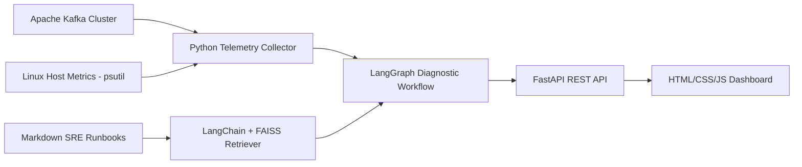

# StreamGuard AI — Kafka Reliability Monitor & Agentic RCA Assistant

A Python + Apache Kafka + LangGraph SRE platform that monitors streaming cluster health and Linux host metrics, retrieves operational runbooks via **LangChain + FAISS RAG**, and generates structured JSON Root Cause Analysis (RCA) reports through a **FastAPI** service and web dashboard.

## Architecture



## Key Features
- **Kafka & Linux Telemetry (`app/telemetry.py`):** Queries live Kafka cluster metadata via `confluent-kafka` (with built-in simulated incident scenarios for local testing/demos) alongside OS CPU, memory, disk I/O, and active network socket counts via `psutil`.
- **LangChain + FAISS RAG (`app/rag.py`):** Indexes Markdown operational runbooks (`runbooks/*.md`) into a FAISS vector store (uses `OpenAIEmbeddings` when `OPENAI_API_KEY` is set, or deterministic local embeddings offline).
- **Stateful LangGraph Agent (`app/agent.py`):** Orchestrates `collect_telemetry -> retrieve_runbooks -> diagnose_and_remediate` to return structured JSON RCA reports with severity, evidence, and remediation CLI commands.
- **FastAPI + Web Dashboard (`app/main.py`, `static/index.html`):** Exposes `/api/metrics`, `/api/simulate-incident`, `/api/diagnose`, and a live browser UI.
- **Containerized & CI-Ready:** Multi-broker KRaft `docker-compose.yml` + GitHub Actions `pytest` workflow (`.github/workflows/ci.yml`).

## Quickstart (Local Python)

```bash
python -m venv .venv
# Windows PowerShell:
.\.venv\Scripts\Activate.ps1
# Linux/macOS:
# source .venv/bin/activate

pip install -r requirements.txt
pytest -v
uvicorn app.main:app --reload
```

Open `http://localhost:8000` in your browser to view the dashboard and trigger simulated Kafka/Linux failures.

## Quickstart (Docker Compose Multi-Broker Kafka)

```bash
docker compose up --build
```

- Kafka Brokers: `localhost:9092`, `localhost:9094`
- StreamGuard AI Dashboard & API: `http://localhost:8000`

## Optional: Enable Live LLM Reasoning

Set `OPENAI_API_KEY` in `.env` or your shell environment to switch `reasoning_mode` from `deterministic_offline` to live `ChatOpenAI` structured RCA synthesis:

```bash
export OPENAI_API_KEY="sk-..."
```
